<!-- ============ HEADER ============ -->
<p align="center">
  
</p>

<p align="center">
  <a href="https://git.io/typing-svg">
    
  </a>
</p>

<p align="center">
  <a href="https://t.me/adu_af"></a>
  <a href="https://t.me/TUIT_DI"></a>
  <a href="https://www.inhayat.uz"></a>
  <a href="https://diabetmed.uz"></a>
  <a href="https://www.npmjs.com/package/@karimov_dev/diabets"></a>
  
</p>

---

### 👨‍💻 Men haqimda

```ts
const azamatjon = {
  location:  "Toshkent, O'zbekiston 🇺🇿",
  role:      "Full-Stack Developer · HealthTech",
  building:  ["InHayat — transplantatsiyaga tayyorgarlik platformasi",
              "Smart Monitor — diabet monitoringi va xavf baholash SDK"],
  stack:     ["TypeScript", "Next.js", "React", "Node.js", "Supabase", "MongoDB"],
  ai:        ["Tool-calling agentlar", "Claude", "Gemini", "Groq"],
  standards: ["HL7 FHIR R4", "WHO FINDRISC", "ADA"],
};
```

- 🏥 Tibbiyot sohasi uchun ishonchli, xavfsiz va foydali dasturlar yarataman
- 🤖 Real loyihalarda AI agentlar: tool calling, audit jurnali, inson tasdig‘i
- 📦 Ochiq kodli SDK muallifi: [`@karimov_dev/diabets`](https://www.npmjs.com/package/@karimov_dev/diabets)
- 💬 Bog‘lanish: [Telegram](https://t.me/adu_af)

---

### 🚀 Asosiy loyihalar

<table>
<tr>
<td width="50%" valign="top">

#### 💚 [InHayat / LifeBridge](https://github.com/Karimov10112/inhayat-uz)
O‘zbekiston bo‘ylab transplantatsiyadan oldingi tayyorgarlikni muvofiqlashtiruvchi platforma: bemor sayti, shifokorlar portali va AI monitoring agenti.

`Next.js 15` `Express 5` `Supabase` `Cloudflare R2` `Claude`

🌐 [inhayat.uz](https://www.inhayat.uz)

</td>
<td width="50%" valign="top">

#### 💙 [Smart Monitor](https://github.com/Karimov10112/smart-monitor)
Diabet monitoringi va asoratlar xavfini baholash: ochiq SDK, REST / FHIR R4 integratsiya, AI agent, veb va Android ilova.

`React` `Node.js` `MongoDB` `Gemini` `Capacitor`

🌐 [diabetmed.uz](https://diabetmed.uz) · 📦 [npm](https://www.npmjs.com/package/@karimov_dev/diabets)

</td>
</tr>
</table>

---

### 🛠 Texnologiyalar

<p align="center">
  <br/>
  
</p>

---

### 📊 GitHub statistika

<p align="center">
  <picture>
    <source media="(prefers-color-scheme: dark)" srcset="./profile/stats-dark.svg"/>
    
  </picture>
  <picture>
    <source media="(prefers-color-scheme: dark)" srcset="./profile/langs-dark.svg"/>
    
  </picture>
</p>

<p align="center">
  <picture>
    <source media="(prefers-color-scheme: dark)" srcset="https://streak-stats.demolab.com?user=Karimov10112&theme=dark&hide_border=true&background=0D1117&ring=39D353&fire=39D353&currStreakLabel=39D353&sideLabels=C9D1D9&dates=8B949E"/>
    
  </picture>
</p>

---

### 🐍 Kontributsiyalar

<p align="center">
  <picture>
    <source media="(prefers-color-scheme: dark)" srcset="https://raw.githubusercontent.com/Karimov10112/Karimov10112/output/snake-dark.svg"/>
    
  </picture>
</p>

<p align="center">
  
</p>
