  

  
  
  
  
  

  

### ⟡ The year, so far

  

Samolyot yil bo‘ylab uchadi va eng faol kunlarga o‘q uzadi.

### ⟡ Work

  

  <a href="https://github.com/Karimov10112/inhayat-uz"><b>InHayat</b></a> ·
  <a href="https://github.com/Karimov10112/smart-monitor"><b>Smart Monitor</b></a> ·
  <a href="https://www.npmjs.com/package/@karimov_dev/diabets"><b>@karimov_dev/diabets</b></a>

### ⟡ Stack

  

  Har bir panel GitHub’dan olingan jonli ma’lumot asosida yaratiladi, SMIL bilan animatsiya qilingan va har 6 soatda yangilanadi.

